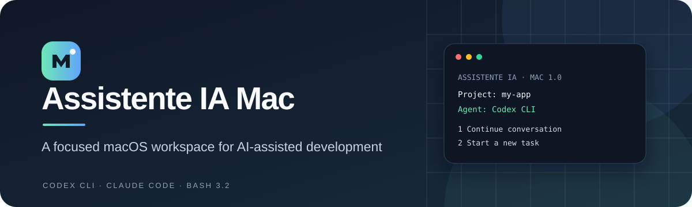

<div align="center">
  
  <br><br>
  <strong>Um ambiente organizado no macOS, Linux e Windows para desenvolver com ajuda de IA.</strong>
  <br>
  Organize projetos, mantenha o contexto junto do código e use Codex CLI ou Claude Code em um único menu.
</div>

# Assistente IA — assistente para macOS, Linux e Windows

## Linux e Windows (versão 1.1)

| Sistema | Como abrir | Requisitos |
| --- | --- | --- |
| macOS | `ASSISTENTE-IA-MAC.command` | Bash 3.2+ e Codex CLI ou Claude Code instalado à parte |
| Linux | `bash ASSISTENTE-IA-LINUX.sh` | Bash, ferramentas Unix, `sha256sum` ou `shasum`; `xdg-open`, `zenity`, `zip` e ferramenta de captura são opcionais para ações gráficas |
| Windows | Dois cliques em `ASSISTENTE-IA-WINDOWS.cmd` | Windows PowerShell 5.1+ e Codex CLI ou Claude Code instalado à parte |

No Windows, o lançador usa `RemoteSigned` apenas no processo aberto. Se o Windows bloquear o script baixado, revise o arquivo e desbloqueie-o nas Propriedades. Ele não altera a política da máquina. Use `ASSISTENTE-IA-WINDOWS.cmd -Check` para verificar o script sem abrir o menu.

Os dois lançadores detectam inglês pelo idioma do sistema; nos demais idiomas usam português do Brasil. É possível trocar no menu ou usar `ASSISTENTE_LANG=en` / `ASSISTENTE_LANG=pt-BR`. A escolha salva prevalece sobre a detecção automática. No Linux, o menu Bash é o mesmo do macOS. No Windows, o menu PowerShell inclui projetos, conversas com Codex/Claude, arquivos de pedidos, status do Git, cópia ZIP, servidor npm e idioma. RTK, painel de uso e verificação automática de projetos ainda não estão no menu Windows.

As preferências ficam em `${XDG_STATE_HOME:-$HOME/.local/state}/assistente-ia` no Linux e `%LOCALAPPDATA%\Assistente IA` no Windows. A localização do macOS continua a mesma.

**Um ambiente bilíngue no terminal para desenvolver com IA.** Organize projetos, reutilize prompts, retome conversas, confira alterações Git e inicie servidores locais em um menu. Na primeira abertura, o programa detecta inglês ou português do Brasil no sistema; você pode salvar outra escolha.

**[Baixar a versão mais recente](https://github.com/Anglersondev/assistente-ia-mac/releases/latest)** · [Como começar](#comece-em-quatro-passos) · [English](README.md)

---

**Idiomas:** [English](README.md) · Português (Brasil)

Projeto mantido por [Anglersondev](https://github.com/Anglersondev). Se ele ajudar você, [apoie o mantenedor](https://pixgg.com/Anglerson).

## O que ele faz

O **Assistente IA Mac** é um conjunto de ferramentas em menu para quem desenvolve com **Codex CLI** e **Claude Code**. Cada projeto ganha um lugar para instruções permanentes, pedidos reutilizáveis, notas e anexos. As conversas continuam nas ferramentas oficiais.

Você pode escolher uma pasta no seletor do sistema ou digitar o caminho, criar um projeto, retomar uma conversa, consultar alterações Git ou iniciar um servidor local. O código pode ficar na raiz, em `CODIGO/` ou em uma subpasta de primeiro nível.

## Recursos

- Um menu para projetos Codex CLI e Claude Code, com a ferramenta escolhida registrada por projeto.
- Projetos em qualquer pasta escolhida por você, inclusive pastas já existentes.
- Instruções duradouras em `INSTRUCOES/PROJETO.md`, ligadas ao `AGENTS.md` ou `CLAUDE.md` do projeto.
- Pedidos reutilizáveis em `PROMPTS/`, enviados apenas quando você os escolhe.
- Continuação de conversas, resumo de encerramento e atalhos opcionais `encerrar` e `resumo`.
- Visualização do estado Git e descoberta de projetos de código em subpastas.
- Servidor local para pacotes Node.js encontrados no projeto.
- Verificação da organização do projeto e integração opcional com RTK.
- Compatibilidade com o Bash 3.2 incluído no macOS.
- Menu em português do Brasil ou inglês: detecta o idioma do sistema na primeira abertura e salva qualquer escolha manual.
- Comandos em inglês quando esse idioma é escolhido: opções do Terminal como `--diagnostics` e `--rtk enable`, além dos atalhos `/wrap-up`, `/summary`, `$wrap-up` e `$summary` criados em projetos novos. Os nomes antigos em português continuam aceitos.

## Comece em quatro passos

1. Baixe e descompacte o arquivo da versão publicada.
2. Mantenha a pasta descompactada inteira, inclusive `lib/`.
3. Abra o lançador do seu sistema conforme a tabela acima.
4. No menu **5**, crie um projeto ou abra uma pasta existente; escolha Codex CLI ou Claude Code.

Na primeira abertura, o programa usa inglês ou português do Brasil conforme o idioma do macOS. Para outros idiomas do sistema, usa português do Brasil. Você pode mudar em **Ajuda e ajustes (7) → Idioma / Language (8)**; a escolha fica salva e tem prioridade sobre o idioma do sistema. Projetos novos organizados recebem modelos de arquivos no idioma selecionado; os arquivos de projetos existentes são preservados.

Se o macOS não abrir o arquivo com dois cliques, use:

```bash
cd /caminho/para/assistente-ia-mac
/bin/bash ASSISTENTE-IA-MAC.command
```

Para verificar o kit sem abrir o menu:

```bash
/bin/bash ASSISTENTE-IA-MAC.command --check
```

Instale e autentique a CLI de Codex ou Claude Code separadamente. O kit não fornece um modelo de IA próprio.

## Organização de um projeto

```text
meu-projeto/
├── AGENTS.md                    # Entrada dos projetos Codex
├── CLAUDE.md                    # Entrada dos projetos Claude Code
├── INSTRUCOES/PROJETO.md       # Instruções permanentes
├── PROMPTS/                     # Pedidos prontos
├── DOCS/                        # Notas e andamento
├── ANEXOS/                      # Material de apoio
├── CODIGO/                      # Código opcional em subpastas
├── .agents/skills/              # Skills opcionais do Codex
├── .claude/commands/            # Comandos opcionais do Claude Code
└── .assistente-ia/tool          # Ferramenta escolhida
```

Não é preciso mover um repositório existente para essa estrutura. Ao organizar um projeto, o kit preserva os arquivos existentes. Leia o [guia completo](GUIA-DE-USO.md) para ver os menus e os fluxos de trabalho.

## Segurança e privacidade

O kit organiza o trabalho, mas não é uma sandbox. Ele evita substituir arquivos gerenciados e pede confirmação para ações que instalam ou atualizam integrações. Não pede nem guarda senhas dos agentes. Comandos Git e npm são executados no projeto ou pacote selecionado; confira os scripts do projeto antes de usá-los. Leia as [notas de auditoria](AUDITORIA-2026-10-23.md) para conhecer os limites.

## Verificação

A versão 1.0 foi verificada no macOS com Bash 3.2.57: 334 testes Python, 156 verificações RTK, análise de sintaxe dos scripts e `--check`. Os testes de integração usam ferramentas simuladas e diretórios isolados; não substituem um teste com suas contas reais.

## Idioma

O programa detecta o idioma do sistema na primeira abertura (inglês ou português do Brasil; outros idiomas usam português do Brasil). A escolha salva tem prioridade. No menu Bash, troque em **Ajuda e ajustes → Idioma / Language**; no Windows, em **Idioma e diagnóstico (6)**. Este README também está disponível em [inglês](README.md).

## Contribuir

Contribuições em português ou inglês são bem-vindas. Abra um pull request para revisão do mantenedor e consulte [CONTRIBUTING.md](CONTRIBUTING.md).

## Apoiar

Você pode doar diretamente ao mantenedor em [PixGG / Anglerson](https://pixgg.com/Anglerson). A doação é opcional e não altera os recursos disponíveis.

## Licença

Distribuído sob a [licença MIT](LICENSE).
